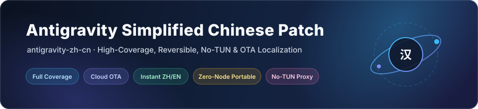
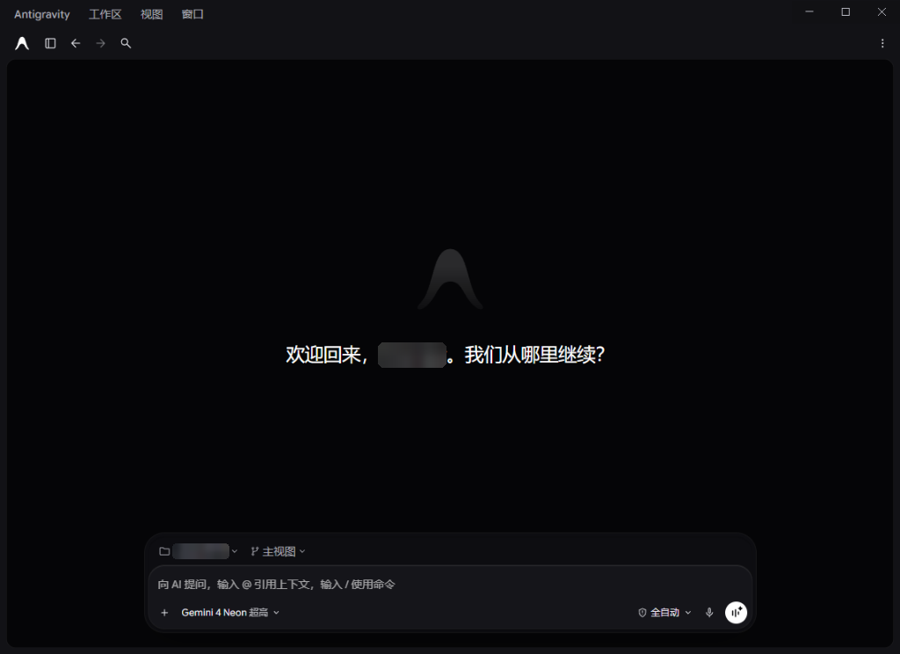
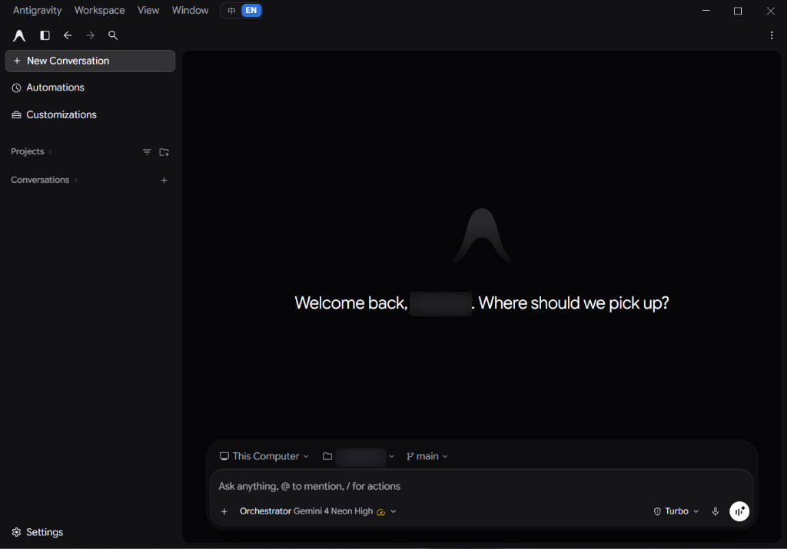
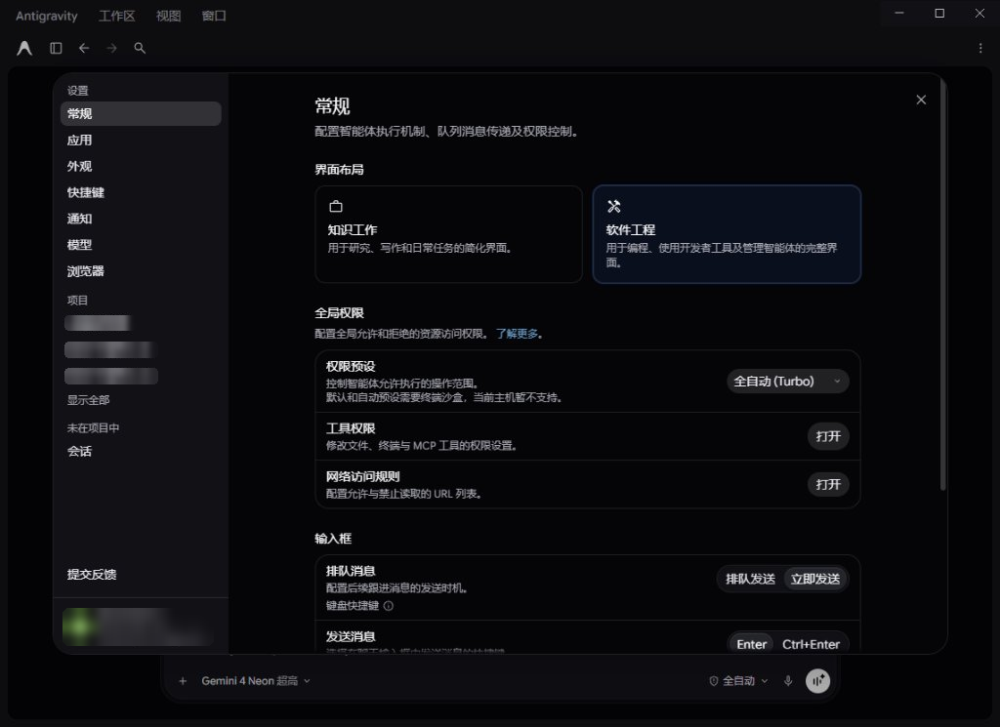
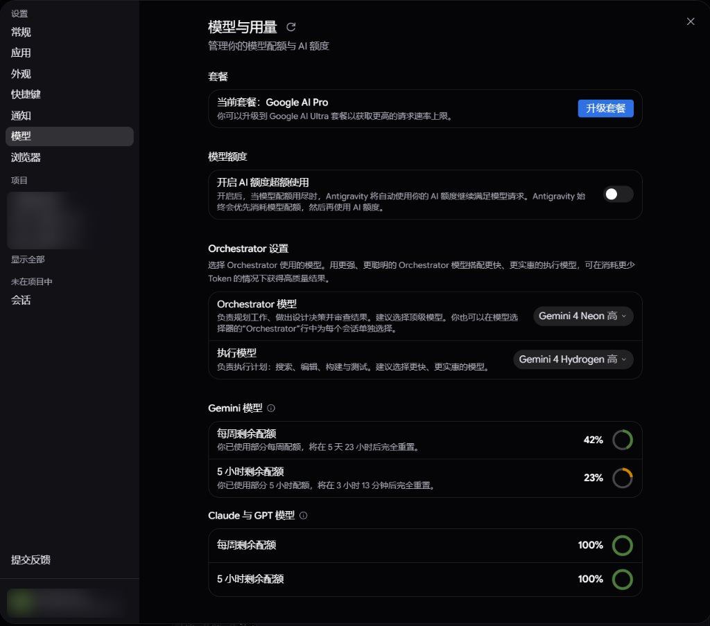
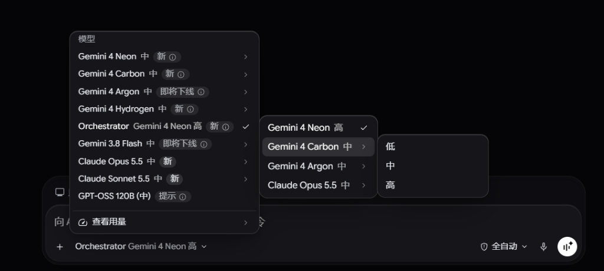
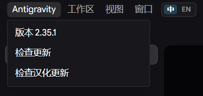
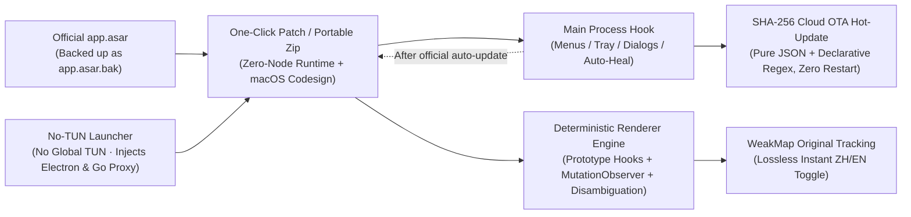

<div align="center">



<br />
<br />

<p><a href="README.md">简体中文</a> | <b>English</b></p>

[](https://github.com/downey37/antigravity-zh-cn/releases)
[](https://github.com/downey37/antigravity-zh-cn/releases)
[](#quick-start)
[](https://github.com/downey37/antigravity-zh-cn/releases/latest)
[](#2-no-tun-launch-windows)
[](https://github.com/downey37/antigravity-zh-cn/stargazers)
[](https://github.com/downey37/antigravity-zh-cn/discussions)
[](LICENSE)

<p><b>A high-coverage, lossless, reversible Simplified Chinese localization suite for the Google Antigravity desktop client — featuring No-TUN networking and Cloud OTA hot-updates.</b></p>

Current version: **`v0.5.1`** (supports Antigravity client `v2.35.1`)

[Previews](#ui-previews) · [Features](#key-features) · [Quick Start](#quick-start) · [ZH/EN Toggle](#advanced-features) · [No-TUN Launch](#2-no-tun-launch-windows) · [Architecture](#how-it-works) · [FAQ](#faq) · [Contributing](#contributing)

</div>

---

## UI Previews

| Home View (Simplified Chinese · Title Bar `[ 中 \| EN ]`) | One-Click Official English View (Zero-Restart Lossless Switch) |
| :---: | :---: |
|  |  |

| General Settings (Permission Policy & Voice Mode) | Models & Usage (Orchestrator & Multi-Dimensional Quotas) |
| :---: | :---: |
|  |  |

| Model Selector & Reasoning Effort Menu (Context-Aware Disambiguation) | Title-Bar `[ 中 \| EN ]` Toggle & OTA Update Menu |
| :---: | :---: |
|  |  |

---

## Key Features

| Capability | Implementation & Highlights |
| :--- | :--- |
| **Full-UI Coverage & Context Disambiguation** | Includes **4250+ static entries + 440+ attribute translations**, dynamic variable templates, and split-node fragment reassembly rules. Uses DOM context to disambiguate homonyms (e.g., `New` badge as `新` vs `新建`, `None` grouping as `不分组` vs reasoning effort as `关闭思考`), skips code blocks, terminals, and user inputs, and preserves brand names (`Antigravity`, `Google Drive`, `Gemini`, `Claude`, `GPT-OSS`). |
| **Zero-Node Portable & Cross-Platform** | Releases ship a self-contained `-portable.zip` with bundled production dependencies that reuses Antigravity's built-in Electron runtime (`ELECTRON_RUN_AS_NODE=1`) — no Node.js required. Supports **Windows 10 / 11** and **macOS** (with automatic deep local `codesign` re-signing after patching). |
| **Instant Title-Bar ZH / EN Toggle** | A persistent **`[ 中 | EN ]`** pill button in the title bar (also accessible via the Help menu and system tray) uses a `WeakMap` to track original strings alongside main-process `_i18nT` dynamic bilingual state, switching instantly without restart and **persisting your preference** across restarts. |
| **Cloud OTA Dictionary Hot-Updates** | Fetches read-only JSON dictionaries and declarative templates from the `ota-dist` branch on startup (SHA-256 verified, zero remote JS execution, zero telemetry) and applies updates **without restarting**. Also supports manual update checks from the menu or disabling via `ANTIGRAVITY_I18N_NO_OTA=1`. |
| **No-TUN Networking & Auto Self-Healing** | **No global TUN virtual adapter needed** (no admin rights required; avoids conflicts with corporate VPNs, WSL/Docker, or games). The companion launcher reads the **Windows system proxy** or probes common local proxy ports (`7897` / `10808` / `7890`) and injects proxy settings into both Electron and the Go backend; falls back cleanly to direct/TUN when no local proxy is found, and auto-repatches after official client updates. |
| **Lossless Backup & One-Click Restore** | Automatically backs up the original core bundle as `app.asar.bak` before first injection, with **one-click restore to official English** and automated Node VM sandbox verification. |

---

## Quick Start

### Option A: Zero-Node Portable Package (Recommended — No Node.js Required)

1. Download the latest `antigravity-zh-cn-vX.Y.Z-portable.zip` from [**GitHub Releases**](https://github.com/downey37/antigravity-zh-cn/releases/latest) and extract it to any folder (**please make sure Antigravity is not running during installation**).
2. Run the one-click installer for your platform:
   - **Windows 10 / 11**: Double-click **`一键修复或更新汉化.bat`** (One-Click Patch / Repair / Update) in the extracted root folder.
   - **macOS**: Open Terminal in the extracted directory and run:
     ```bash
     chmod +x install_macos.sh restore_macos.sh
     ./install_macos.sh
     ```
     > [!TIP]
     > `install_macos.sh` automatically runs local ad-hoc deep signing (`codesign --force --deep --sign -`) on `/Applications/Antigravity.app` after patching. If permission is denied, run `sudo ./install_macos.sh`.
3. Once verification passes, completely quit Antigravity with **`Ctrl + Q`** (Windows) or **`Cmd + Q`** (macOS) (or exit from the system tray), then reopen it to enjoy the Simplified Chinese UI.

---

### Option B: Build from Source (For Developers & Maintainers)

**Prerequisites**: Antigravity desktop client installed, plus [Node.js](https://nodejs.org/) (`>= 20.19`, `22+` recommended).

```powershell
git clone https://github.com/downey37/antigravity-zh-cn.git
cd antigravity-zh-cn
npm install

# Windows: build, deploy, and verify in one command
npm run deploy

# macOS: deploy, re-sign, and verify
./install_macos.sh
```

---

### One-Click Restore to Official English

Before first deployment, the patcher backs up the untouched official bundle as `app.asar.bak`. You can restore it losslessly at any time:

- **Windows**: Double-click **`一键还原官方英文.bat`** (One-Click Restore Official English) in the root folder (or run `npm run restore` in the repo).
- **macOS**: Run **`./restore_macos.sh`** (or `npm run restore`).
- After restoration completes, press `Ctrl + Q` / `Cmd + Q` to fully quit and relaunch Antigravity.

---

## Advanced Features

### 1. Instant Title-Bar ZH / EN Toggle

Just like a browser page translator's original/translated toggle, you can switch instantaneously between **Simplified Chinese** and **100% pure official English** without restarting the app — and your choice is **automatically remembered** across restarts:

- Persistent title-bar pill button: **`[ 中 | EN ]`** (one click to toggle)
- Native menu bar: **Help → 切换为英文原文 (关闭汉化) / 切换为简体中文 (开启汉化)**
- System tray context menu: **切换为英文原文 (关闭汉化) / 切换为简体中文 (开启汉化)**

Toggling synchronizes across the main window, plugin panels, SSH remote windows, native menus, tray menu, system notifications, native dialogs, updater status steps, WebView security prompts, and onboarding/remote pages, persisting state to `i18n-cache/state.json` under the user data directory.

---

### 2. No-TUN Launch (Windows)

Antigravity's background Go core does not always honor Windows system proxy settings out of the box, often forcing users to enable global TUN mode (which can interfere with corporate intranets, VPNs, WSL/Docker, or games). Double-clicking **`一键免TUN启动.bat`** (No-TUN Launch) or running `node scripts/guard_launch.js` provides **No-TUN networking + automatic post-update self-healing**:

1. **Pre-launch self-healing**: Checks `app.asar` in milliseconds; if an official update overwrote it, the patch is automatically re-applied before launch.
2. **End-to-end proxy auto-injection (Electron frontend + Go backend, no hardcoded ports)**: Keep your proxy client in normal system proxy or local-port listening mode (no TUN adapter needed). The launcher resolves the proxy in the following priority order:

| Priority | Source / Rule | Notes |
| :---: | :--- | :--- |
| **1** | `ANTIGRAVITY_PROXY` environment variable | Highest-priority explicit override (e.g., `http://127.0.0.1:7897`); set to `direct` / `none` to **force direct connection** |
| **2** | Windows current system proxy | Automatically reads `ProxyEnable` and `ProxyServer` from `HKCU\...\Internet Settings` (supports `http`/`https`/`socks`) |
| **3** | Launch argument `--proxy-server=...` | Proxy address passed via shortcut or CLI flag |
| **4** | Common local proxy port probing | Parallel TCP probes for `127.0.0.1:7897` (Clash Verge Rev) → `10808` (v2rayN) → `7890` (Clash) |
| **5** | Direct / TUN fallback | If no active local proxy is detected (or `ANTIGRAVITY_AUTO_PROXY=0`), clears stale proxy env vars and connects directly / via TUN |

---

## How It Works



---

## FAQ

<details>
<summary><b>1. Is this patch safe? Does it upload data or alter network requests?</b></summary>
<p>Yes — the project is 100% open source and transparent. The repository contains only translation dictionaries and local injection scripts with no closed-source binaries. The runtime engine strictly isolates <code>plugin://</code>, <code>vscode-webview://</code>, and same-origin pages so third-party sites or local dev previews are never touched. Cloud OTA pulls read-only JSON dictionaries from the GitHub <code>ota-dist</code> branch with SHA-256 verification, zero remote script execution, and zero telemetry. To run completely offline, set <code>ANTIGRAVITY_I18N_NO_OTA=1</code>.</p>
</details>

<details>
<summary><b>2. Will an official Antigravity auto-update break the localization?</b></summary>
<p>The project includes <b>dual self-healing</b>: the main-process updater hook automatically re-injects the patch after an update finishes, and launching via <code>一键免TUN启动.bat</code> checks and repairs <code>app.asar</code> before startup. If a major client release introduces new UI strings, simply re-run the one-click update script or wait for a Cloud OTA dictionary push.</p>
</details>

<details>
<summary><b>3. Can I use this without installing Node.js?</b></summary>
<p><b>Yes!</b> Download the zero-dependency <code>-portable.zip</code> archive from Releases. All batch/shell scripts automatically use Antigravity's built-in Electron runtime (<code>ELECTRON_RUN_AS_NODE=1</code>) for patching, verification, restoration, and No-TUN launch — no standalone Node.js required.</p>
</details>

<details>
<summary><b>4. How can I compare with the official English UI without uninstalling the patch?</b></summary>
<p>Click the persistent <b><code>[ 中 | EN ]</code></b> toggle in the top title bar (or use the Help menu / system tray menu) to switch instantaneously to 100% pure official English — including native menus, dialogs, and remote prompts — without restarting. Click again to switch back to Simplified Chinese; your selection is saved across restarts.</p>
</details>

<details>
<summary><b>5. How does networking work without TUN mode? Does it conflict if I already use TUN?</b></summary>
<p><b>Zero conflicts — both modes work cleanly:</b></p>
<ul>
<li><b>Without TUN (No-TUN mode)</b>: Keep Clash Verge Rev / v2rayN / Clash in standard system proxy mode and launch via <code>一键免TUN启动.bat</code> to automatically inject proxy settings into both Electron and the Go backend.</li>
<li><b>Already using global TUN / direct</b>: When Windows system proxy is off and ports <code>7897 / 10808 / 7890</code> are not listening, the launcher clears stale proxy env vars and connects cleanly over direct/TUN. Set <code>ANTIGRAVITY_PROXY=direct</code> or <code>ANTIGRAVITY_AUTO_PROXY=0</code> to disable auto-probing explicitly.</li>
</ul>
</details>

<details>
<summary><b>6. How do I report untranslated strings or mistranslations?</b></summary>
<p>Please open an <a href="https://github.com/downey37/antigravity-zh-cn/issues/new/choose">Issue (Untranslated / Mistranslation Report)</a> or post in <a href="https://github.com/downey37/antigravity-zh-cn/discussions">Discussions</a> with the original English text and a screenshot. Confirmed additions are pushed directly to all users via Cloud OTA.</p>
</details>

---

## Environment Variables & Developer Guide

<details>
<summary><b>Click to expand: Optional Environment Variables, Directory Structure & Dev Commands</b></summary>

### Optional Environment Variables

| Variable | Description | Default / Example |
| :--- | :--- | :--- |
| `ANTIGRAVITY_RESOURCES` | Custom client `resources` directory | Windows: `%LOCALAPPDATA%\Programs\antigravity\resources`<br/>macOS: `/Applications/Antigravity.app/Contents/Resources` |
| `ANTIGRAVITY_DIR` / `ANTIGRAVITY_APP` | Custom install root or macOS `.app` bundle path | e.g., `/Applications/Antigravity.app` |
| `ANTIGRAVITY_EXE` | Custom executable path | e.g., `D:\Apps\Antigravity\Antigravity.exe` |
| `ANTIGRAVITY_I18N_DISABLED` | Set to `1` to force-start in English (does not overwrite persisted toggle state) | Unset (reads saved state, defaults to Chinese) |
| `ANTIGRAVITY_I18N_NO_OTA` | Set to `1` to disable Cloud OTA dictionary updates | Unset (enabled by default) |
| `ANTIGRAVITY_I18N_OTA_URL` | Custom OTA feed URL (supports comma-separated fallbacks) | GitHub Raw + jsDelivr |
| `ANTIGRAVITY_I18N_OTA_INTERVAL_MS` | Background OTA polling interval in milliseconds | `7200000` (2 hours) |
| `ANTIGRAVITY_I18N_AUTO_MT` | Enable async machine-translation fallback for allowlisted dynamic notice cards (also toggleable via Help menu) | Enabled by default (`0` to disable) |
| `ANTIGRAVITY_I18N_MT_PROVIDER` / `ANTIGRAVITY_I18N_MT_URL` / `ANTIGRAVITY_I18N_MT_API_KEY` / `ANTIGRAVITY_I18N_MT_MODEL` | Machine-translation provider config for dynamic notices (keyless `google-gtx` by default; supports `openai`-compatible APIs or local Ollama) | `google-gtx` |
| `ANTIGRAVITY_PROXY` / `ANTIGRAVITY_NO_PROXY` | Explicit proxy override (`direct` forces direct connection) and bypass list | e.g., `http://127.0.0.1:7897` |
| `ANTIGRAVITY_AUTO_PROXY` | Set to `0` to disable automatic port probing in `guard_launch.js` | Enabled by default |

### Directory Structure

- `assets/`: Dictionaries and allowlists
  - `dictionary.json`: Primary static dictionary
  - `attr_dict.json`: Attribute translations (`title` / `aria-label` / `placeholder`, etc.)
  - `preserve_list.json`: Brand & proper-noun allowlist kept untranslated
  - `ota_rules.json`: Pure-data declarative regex templates for Cloud OTA
  - `baseline/version.json`: Current supported client baseline metadata
- `scripts/`: Patching, restoration, portable packaging, and verification scripts
  - `engine/`: Runtime engine modules (`dynamic_rules.js`, `context_rules.js`, `split_node_rules.js`, `runtime_bootstrap.js`)
  - `ota/`: Main-process OTA & persisted ZH/EN toggle broadcaster (`i18n_ota_main.js`)
  - `runtime_paths.js`: Cross-platform install path resolver & macOS auto-signing helper
  - `i18n_core.js`: Patches `app.asar.bak` with main-process & renderer hooks and deploys
  - `restore_antigravity.js`: Verifies and restores `app.asar.bak` back to official English
  - `guard_launch.js` / `auto_patch_on_update.js`: No-TUN proxy-probing launcher & update self-healer
  - `build_clean_engine.js` / `build_ota_pack.js` / `build_portable_release.js`: Engine, OTA pack, and zero-Node portable builders
  - `scan_updates.js` / `verify_engine.js` / `release_version.js`: Baseline scanner, Node VM regression suite, and SemVer release tool
- `docs/`: Architecture notes, file manifest, and maintenance guides

### Common Developer Commands

```powershell
npm run build           # Build renderer injection bundle (build/i18n.js)
npm run build:ota       # Build Cloud OTA dictionary pack (build/ota/*)
npm run build:portable  # Build zero-Node portable release (build/*-portable.zip & .sha256)
npm run verify:local    # Run sandbox verification for build, OTA, proxy probing & restore
npm run deploy          # Build, deploy, and verify against local Antigravity app.asar
npm run restore         # Restore local Antigravity installation to official English
npm run scan            # Refresh baseline after client update and scan for new strings
npm run version:check   # Verify version, baseline, and README consistency
npm run version:bump -- patch --dry-run  # Preview a SemVer version bump
```

For architectural deep dives and update maintenance workflows, see [docs/session_continuation_handover.md](docs/session_continuation_handover.md) and [docs/i18n_architecture_and_history.md](docs/i18n_architecture_and_history.md).

</details>

---

## Versioning

This project strictly follows three-part Semantic Versioning (`vMAJOR.MINOR.PATCH`), paired with the targeted Antigravity client version:

- **Patch (`PATCH`)**: Missing-string additions, translation refinements, rule tweaks, and documentation updates within the same Antigravity client version.
- **Minor (`MINOR`)**: Adaptation to a new Antigravity client release or significant new engineering features.
- **Major (`MAJOR`)**: Reserved for `1.0.0` once architecture & coverage stabilize, and breaking changes thereafter.
- **Dual-Version Title Convention**: Every GitHub Release is titled **`vX.Y.Z (适配 Antigravity vA.B.C)`**, matching the top compatibility badge.

---

## Contributing

[Issues](https://github.com/downey37/antigravity-zh-cn/issues), [Pull Requests](https://github.com/downey37/antigravity-zh-cn/pulls), and feedback in [Discussions](https://github.com/downey37/antigravity-zh-cn/discussions) are warmly welcome!

## Disclaimer

- This is an unofficial community localization patch containing only translation dictionaries and automated injection scripts — **no official Antigravity binaries or proprietary artifacts are included**.
- Provided for educational and personal use; please check client version compatibility before patching local files.

## License

[MIT](LICENSE)

---

<div align="center">
If you find this project helpful, please consider giving it a ⭐ <b>Star</b>!
</div>
