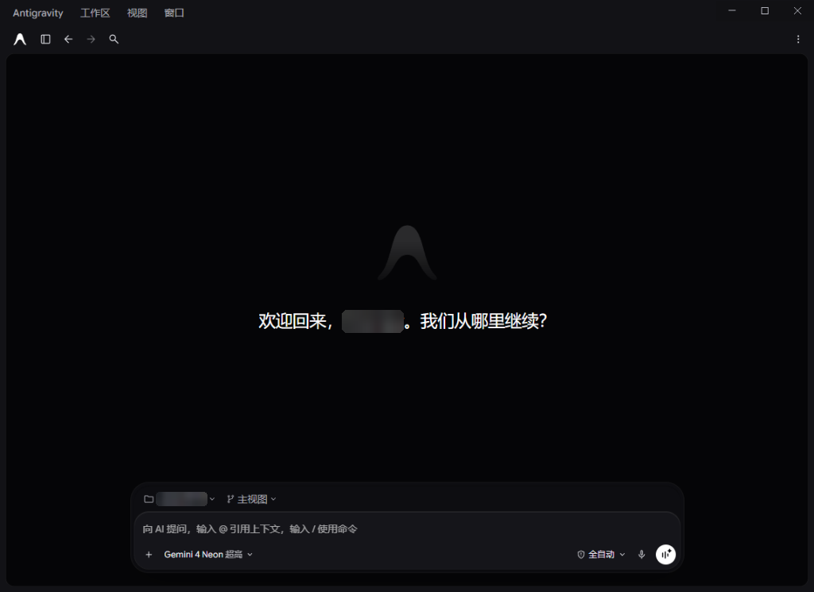
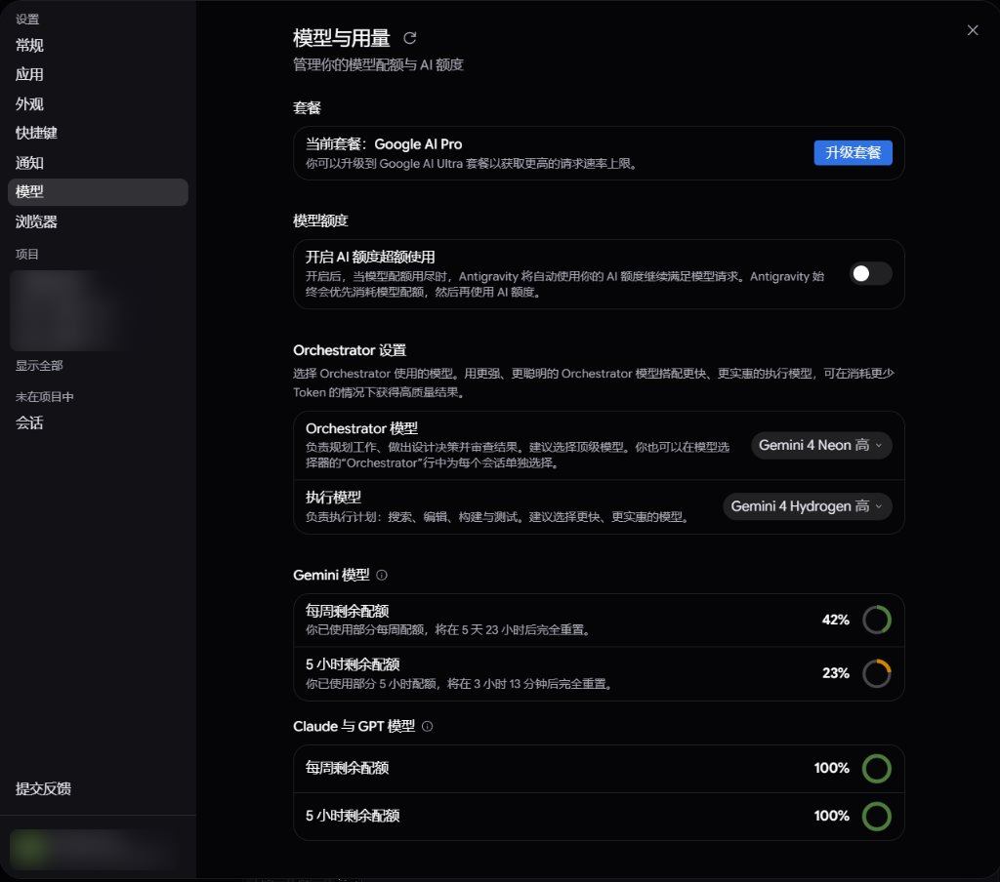

# Antigravity 简体中文汉化补丁 (`antigravity-zh-cn`)

[](https://github.com/downey37/antigravity-zh-cn/releases)
[](https://github.com/downey37/antigravity-zh-cn/releases)
[](https://github.com/downey37/antigravity-zh-cn/discussions)
[](LICENSE)

**Antigravity 桌面客户端（Windows）** 全界面简体中文汉化补丁与跟版维护工程，当前版本：**`v0.2.4`**（适配 Antigravity 客户端 `v2.34.0`）。

## 界面效果预览

| 主界面 | 常规设置 |
| :---: | :---: |
|  |  |

**模型与用量（含 Orchestrator 设置）**



## 特性亮点

- **全界面高覆盖翻译**：涵盖主进程原生菜单、系统托盘、弹窗、设置页、侧边栏、Tooltip 浮层与动态提示（4060+ 条静态词库 + 390+ 条属性译文 + 动态模板规则）。
- **上下文精准消歧**：针对同词多义（如 `New`、`None` 等）按 DOM 上下文精确区分，避免全局替换误伤。
- **代码与专有名词保护**：自动避开代码块、终端输出与用户输入区域；保留 `Antigravity`、`Google Drive` 及模型原名（`Gemini`、`Claude`、`GPT-OSS` 等）。
- **云端词库热更新（OTA）**：客户端启动后自动从 `ota-dist` 通道静默拉取最新纯 JSON 词库与声明式模板（SHA-256 校验、零远端 JS 执行、零遥测），**免重启实时生效**；也可在顶部左上角 **「Antigravity → 检查汉化更新」** 或系统托盘右键 **「检查汉化更新」** 随时手动触发，或通过 `ANTIGRAVITY_I18N_NO_OTA=1` 禁用联网同步。
- **无损备份与自动校验**：首次打补丁自动备份官方原版 `app.asar` 为 `app.asar.bak`，部署完成后自动执行 Node VM 沙箱回归校验。
- **跟版扫漏工具**：支持在官方版本更新后一键从客户端缓存提取最新前端基线并扫描未翻译词条。

---

## 环境要求

- **操作系统**：Windows 10 / 11
- **运行环境**：[Node.js](https://nodejs.org/)（建议 v18+）
- 已安装 Antigravity 桌面客户端

---

## 快速安装使用

### 1. 克隆仓库并安装依赖

```powershell
git clone https://github.com/downey37/antigravity-zh-cn.git
cd antigravity-zh-cn
npm install
```

### 2. 一键应用汉化补丁

方式一（命令行）：

```powershell
npm run deploy
```

方式二（图形化）：

直接双击项目根目录的 **`一键修复或更新汉化.bat`**。

### 3. 重启客户端生效

在 Antigravity 窗口内按 **`Ctrl + Q`** 彻底退出（或右键系统托盘退出），然后重新打开即可看到简体中文界面。

---

## 如何恢复官方英文原版

部署脚本在首次修改前会自动将官方原始文件备份为 `app.asar.bak`。如需还原：

1. 按 `Ctrl + Q` 彻底退出 Antigravity。
2. 打开目录 `%LOCALAPPDATA%\Programs\antigravity\resources\`。
3. 删除 `app.asar`，并将 `app.asar.bak` 重命名为 `app.asar` 即可。

---

## 环境变量说明（可选）

如果您的 Antigravity 安装在非默认路径，或需要为客户端单独配置局部代理，可通过环境变量自定义：

- `ANTIGRAVITY_RESOURCES`：自定义 `resources` 目录路径（默认 `%LOCALAPPDATA%\Programs\antigravity\resources`）。
- `ANTIGRAVITY_DIR` / `ANTIGRAVITY_EXE`：自定义安装根目录与 `Antigravity.exe` 路径。
- `ANTIGRAVITY_PROXY` / `ANTIGRAVITY_NO_PROXY`：可选的局部代理地址（默认**关闭**，不修改任何代理设置；仅当显式设置如 `http://127.0.0.1:7890` 时为客户端与后台进程启用）。
- `ANTIGRAVITY_I18N_NO_OTA`：设为 `1` 时禁用在线词库热更新，仅使用本地内置词库（默认开启，仅单向只读拉取纯 JSON，零遥测）。
- `ANTIGRAVITY_I18N_OTA_URL`：可选自定义 OTA 源地址（支持逗号分隔多源回退，默认主源 `raw.githubusercontent.com` + 备用源 `cdn.jsdelivr.net`）。
- `ANTIGRAVITY_I18N_OTA_INTERVAL_MS`：自定义后台静默轮询间隔毫秒数（默认 `7200000`，即 2 小时）。

---

## 版本号说明

本项目采用严格三段式语义化版本（`vMAJOR.MINOR.PATCH`），并与适配的客户端版本双线对应：

- **修订号 (`PATCH`)**：同一 Antigravity 客户端版本内的漏翻补全、译文修正、规则微调与文档更新（例如 `v0.2.3` → `v0.2.4`）。
- **次版本号 (`MINOR`)**：适配新版 Antigravity 官方客户端或新增重要工程能力（例如适配 `v2.35.0` 时发布 `v0.3.0`，固定写满三位，不使用两段式 `v0.3`）。
- **主版本号 (`MAJOR`)**：`0.x.y` 表示打磨与高频迭代期；当架构定型且核心界面覆盖稳定后将升级为 `1.0.0`，此后仅在发生不兼容重大变更时递增。
- **双版本标识约定**：每次 GitHub Release 标题统一使用 **`vX.Y.Z (适配 Antigravity vA.B.C)`**，并与本页顶部的适配客户端徽章保持同步。

---

## 参与贡献与跟版维护

欢迎提交 [Issue](https://github.com/downey37/antigravity-zh-cn/issues)、[Pull Request](https://github.com/downey37/antigravity-zh-cn/pulls)，或前往 [Discussions](https://github.com/downey37/antigravity-zh-cn/discussions) 交流翻译建议与使用反馈！

### 目录结构

- `assets/`：词库与白名单（日常修改译文主要编辑这里）
  - `dictionary.json`：主静态词库
  - `attr_dict.json`：`title` / `aria-label` / `placeholder` 等属性译文表
  - `preserve_list.json`：保留英文不译的品牌与专有名词白名单
  - `ota_rules.json`：云端可热更的纯数据声明式正则模板
  - `baseline/version.json`：当前适配基线版本信息
- `scripts/`：构建、部署、跟版扫描与回归校验脚本
  - `engine/`：运行时注入引擎子模块（`dynamic_rules.js`、`context_rules.js`、`split_node_rules.js`、`runtime_bootstrap.js`）
  - `ota/`：主进程云端词库热同步模块（`i18n_ota_main.js`）
  - `build_clean_engine.js`：组装生成 `build/i18n.js`
  - `build_ota_pack.js`：生成 OTA 发布产物 `build/ota/manifest.json` 与 `dict-pack.json`
  - `i18n_core.js`：基于 `app.asar.bak` 植入主进程与前端引擎并打包部署
  - `scan_updates.js`：客户端升级后刷新本地基线并扫描未翻译文案
  - `verify_engine.js`：Node VM 沙箱回归校验
  - `release_version.js`：三段式版本号校验与发版信息同步工具
- `docs/`：架构说明、文件清单与维护指南

### 常用开发命令

```powershell
# 仅构建前端注入脚本（生成 build/i18n.js）
npm run build

# 生成 OTA 云端词库包（生成 build/ota/manifest.json 与 dict-pack.json）
npm run build:ota

# 仅校验本地构建产物（无需修改已安装客户端）
npm run verify:local

# 完整编译、部署并校验已安装的 app.asar
npm run deploy

# 客户端升级后，从本地缓存刷新基线并扫描新增未翻译英文
npm run scan

# 校验 package.json、基线版本与 README 版本信息一致性
npm run version:check

# 预演/升级三段式版本号并生成标准 Tag 与 Release 命令（支持 patch / minor / major / X.Y.Z）
npm run version:bump -- patch --dry-run
```

更多架构细节与跟版流程请查阅 [docs/session_continuation_handover.md](docs/session_continuation_handover.md) 与 [docs/i18n_architecture_and_history.md](docs/i18n_architecture_and_history.md)。

---

## 免责声明

- 本项目为社区非官方汉化补丁，仅包含翻译词库与自动化注入脚本，**不包含任何 Antigravity 官方二进制或闭源产物**。
- 仅供学习与交流使用，使用本工具修改本地客户端文件前请自行留意版本兼容性。

## License

[MIT](LICENSE)
