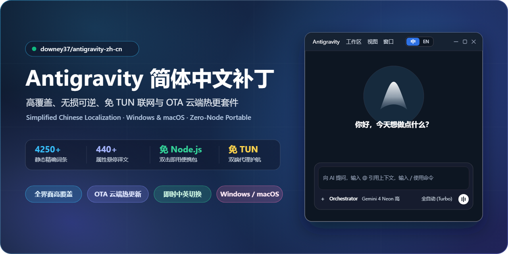
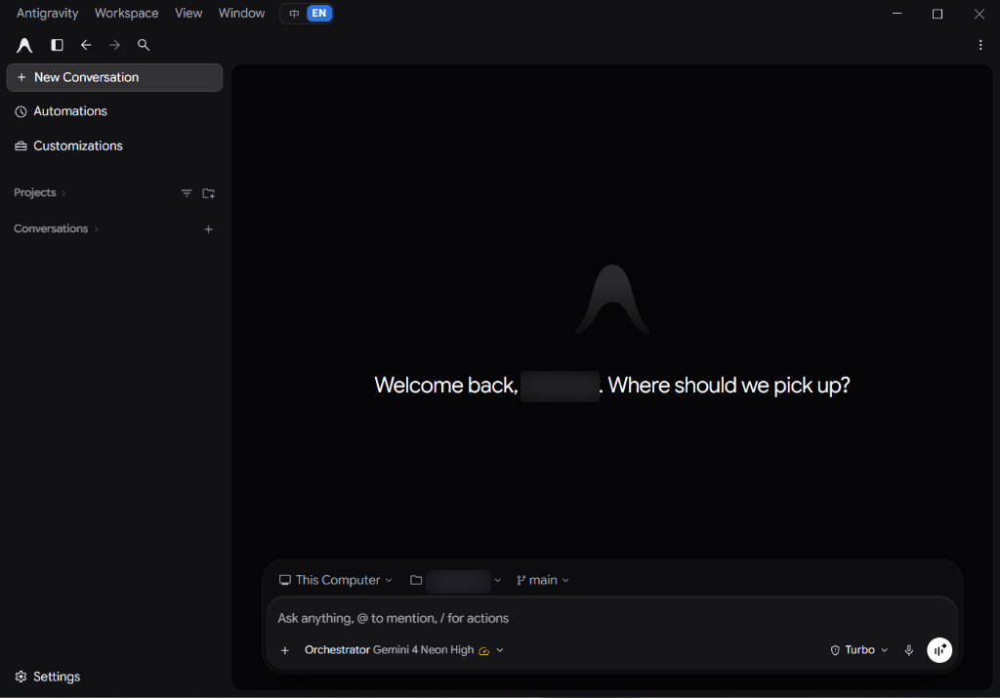
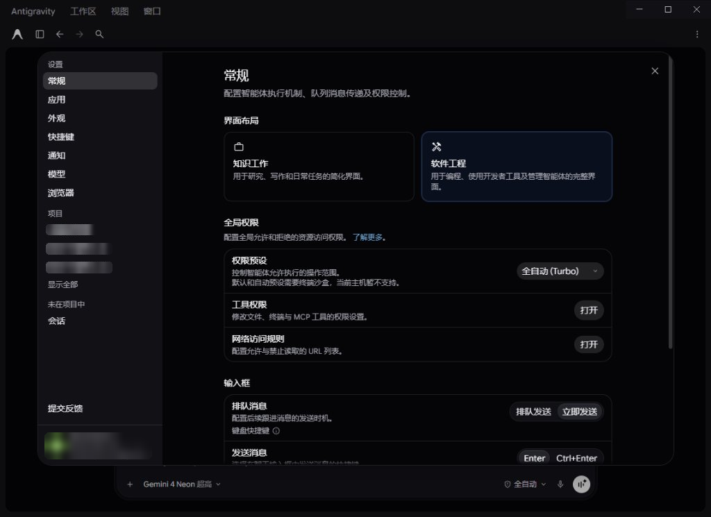
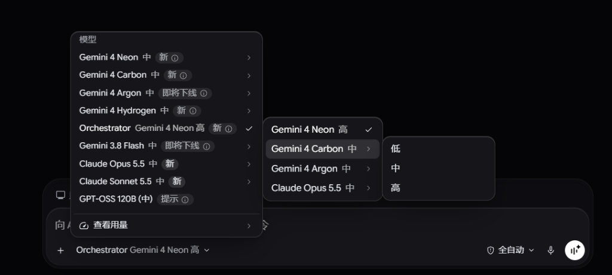
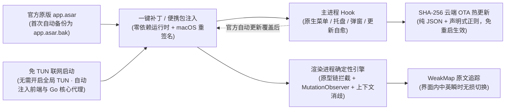

<div align="center">



<br />
<br />

<p><b>简体中文</b> | <a href="README.en.md">English</a></p>

[](https://github.com/downey37/antigravity-zh-cn/releases)
[](https://github.com/downey37/antigravity-zh-cn/releases)
[](https://github.com/downey37/antigravity-zh-cn/releases)
[](#快速安装使用)
[](https://github.com/downey37/antigravity-zh-cn/releases/latest)
[](#2-免-tun-联网启动windows)
[](https://github.com/downey37/antigravity-zh-cn/stargazers)
[](https://github.com/downey37/antigravity-zh-cn/discussions)
[](LICENSE)

<p><b>专为 Google Antigravity 桌面客户端打造的高覆盖、无损可逆、支持免 TUN 联网与 OTA 热更的简体中文本地化套件。</b></p>

当前版本：**`v0.6.0`**（适配 Antigravity 客户端 `v2.35.1`）

[界面预览](#界面效果预览) · [核心特性](#核心特性一览) · [快速安装](#快速安装使用) · [中英切换](#实用进阶功能) · [免 TUN 联网](#2-免-tun-联网启动windows) · [架构原理](#工作原理) · [常见问题](#常见问题-faq) · [参与贡献](#参与贡献与维护)

</div>

---

## 界面效果预览

<p align="center">
  <a href="https://raw.githubusercontent.com/downey37/antigravity-zh-cn/main/docs/images/preview-home.png" title="点击查看高清原图">
    
  </a>
  <br />
  <sub><b>主界面简体中文效果</b> · 顶部标题栏配备主题自动联动、支持点击或拖拽滑动的 <code>[ 中 | EN ]</code> 开关（点击任意图片可直接打开高清原图）</sub>
</p>

<details>
<summary><b>对比查看：一键切换为 100% 官方英文原文（零重启无损还原）</b></summary>
<p align="center">
  <a href="https://raw.githubusercontent.com/downey37/antigravity-zh-cn/main/docs/images/preview-home-en.png" title="点击查看高清原图">
    
  </a>
  <br />
  <sub><b>一键切换官方英文原文</b> · 无需重启客户端，原生菜单、托盘与界面瞬间还原官方英文</sub>
</p>
</details>

<p align="center">
  <a href="https://raw.githubusercontent.com/downey37/antigravity-zh-cn/main/docs/images/preview-settings-general.png" title="点击查看高清原图">
    
  </a>
  &nbsp;
  <a href="https://raw.githubusercontent.com/downey37/antigravity-zh-cn/main/docs/images/preview-settings-models.png" title="点击查看高清原图">
    
  </a>
  <br />
  <sub><b>左</b>：常规设置（权限策略与语音模式） &nbsp;|&nbsp; <b>右</b>：模型与用量（Orchestrator 与多维度配额）</sub>
</p>

<p align="center">
  <a href="https://raw.githubusercontent.com/downey37/antigravity-zh-cn/main/docs/images/preview-model-selector.png" title="点击查看高清原图">
    
  </a>
  &nbsp;
  <a href="https://raw.githubusercontent.com/downey37/antigravity-zh-cn/main/docs/images/preview-titlebar-menu.png" title="点击查看高清原图">
    
  </a>
  <br />
  <sub><b>左</b>：模型选择器与思考深度菜单（浅色主题 · 含「新」徽章精准消歧） &nbsp;|&nbsp; <b>右</b>：深/浅双主题联动 <code>[ 中 | EN ]</code> 开关与 OTA 更新入口</sub>
</p>

---

## 核心特性一览

| 核心能力 | 实现方式与亮点 |
| :--- | :--- |
| **全界面高覆盖与精准消歧** | 收录 **4740+ 条静态词库 + 450+ 条属性译文**、动态变量模板与跨节点碎片重组规则；按 DOM 上下文精确区分同词多义（如 `New` 徽章 vs `新建`、`None` 分组为 `不分组` vs 思考深度为 `关闭思考`），并自动避开代码块、终端与用户输入区域，保留 `Antigravity`、`Google Drive`、`Gemini`、`Claude`、`GPT-OSS` 等原名。 |
| **零依赖便携包与跨平台支持** | Releases 提供内置生产依赖的免 Node.js 便携包（`-portable.zip`），直接复用客户端自带 Electron 运行时执行注入；支持 **Windows 10 / 11** 与 **macOS**（修改后自动执行本地 `codesign` 深度签名）。 |
| **顶部标题栏一键原文 / 译文切换** | 在顶部标题栏常驻 **`[ 中 \| EN ]`** 胶囊开关（自动适配客户端深色 / 浅色主题，支持点击或拖拽滑动切换及果冻弹性动效，也可从菜单/托盘触发），基于 `WeakMap` 精确追踪原文并联动主进程 `_i18nT` 动态双语，无需重启即可在简体中文与 100% 纯净官方英文原文间无损切换，并**自动记住切换状态**跨重启保留。 |
| **云端词库热更新与动态公告兜底** | 启动后自动从 `ota-dist` 通道单向只读拉取纯 JSON 词库与声明式模板（SHA-256 校验、零远端 JS 执行、零遥测），**免重启实时生效**；内置白名单动态公告异步机翻兜底（默认免 Key `google-gtx`，可选 OpenAI/Ollama，可在「帮助 → 自动翻译动态公告」随时开关），亦支持菜单手动检查或 `ANTIGRAVITY_I18N_NO_OTA=1` 禁用。 |
| **免 TUN 联网与更新自愈** | **无需开启全局 TUN 虚拟网卡**（免管理员权限，不干扰公司内网、VPN、WSL / Docker 与游戏）；配套一键启动脚本自动读取 **Windows 系统代理** 或探测常见本地代理端口（`7897` / `10808` / `7890`），同步为 Electron 前端与后台 Go 核心注入代理参数，普通系统代理即可全链路稳定联网；未检测到本地代理时干净走直连 / TUN，同时在官方客户端更新后自动唤醒自愈重打补丁。 |
| **无损备份与一键还原** | 首次注入前自动备份原版核心为 `app.asar.bak`，支持 **一键还原官方英文原版** 与自动化 Node VM 沙箱回归校验。 |

---

## 快速安装使用

### 方案 A：零依赖便携包（推荐普通用户，无需安装 Node.js）

1. 前往 [**GitHub Releases**](https://github.com/downey37/antigravity-zh-cn/releases/latest) 下载最新的 `antigravity-zh-cn-vX.Y.Z-portable.zip` 并解压到任意英文或中文目录（**请勿在安装过程中运行 Antigravity**）。
2. 根据你的系统执行一键安装：
   - **Windows 10 / 11**：直接双击根目录的 **`一键修复或更新汉化.bat`**。
   - **macOS**：在终端进入解压目录执行：
     ```bash
     chmod +x install_macos.sh restore_macos.sh
     ./install_macos.sh
     ```
     > [!TIP]
     > `install_macos.sh` 会在注入完成后自动为 `/Applications/Antigravity.app` 执行本地 Ad-hoc 深度签名（`codesign --force --deep --sign -`）。如提示权限不足，可使用 `sudo ./install_macos.sh`。
3. 看到校验通过提示后，在 Antigravity 窗口内按 **`Ctrl + Q`**（macOS 按 **`Cmd + Q`**）彻底退出客户端（或右键系统托盘退出），再重新打开即可使用简体中文界面。

---

### 方案 B：源码克隆（适合开发者与跟版维护）

**环境要求**：已安装 Antigravity 客户端，以及 [Node.js](https://nodejs.org/)（`>= 20.19` / 推荐 `22+`）。

```powershell
git clone https://github.com/downey37/antigravity-zh-cn.git
cd antigravity-zh-cn
npm install

# Windows 一键编译、部署并校验：
npm run deploy

# macOS 一键部署并签名校验：
./install_macos.sh
```

---

### 一键还原官方英文原版

补丁脚本在首次部署前已将官方原始核心备份为 `app.asar.bak`。随时可无损还原：

- **Windows**：双击根目录的 **`一键还原官方英文.bat`**（或在仓库目录运行 `npm run restore`）。
- **macOS**：运行 **`./restore_macos.sh`**（或 `npm run restore`）。
- 还原完成后按 `Ctrl + Q` / `Cmd + Q` 彻底退出并重开 Antigravity 即可恢复官方英文原版。

---

## 实用进阶功能

### 1. 顶部标题栏一键中 / 英文原文切换

如同浏览器翻译插件的「原文 / 译文」切换一样，无需重启客户端即可随时在 **简体中文** 与 **100% 纯净官方英文原文** 间瞬时切换，且**偏好会自动记住**，下次启动仍保持你的选择：

- 顶部标题栏常驻胶囊开关：**`[ 中 | EN ]`**（自动同步深浅色主题，支持点击或横向拖拽滑块切换）
- 顶部原生菜单栏：**「帮助 → 切换为英文原文 (关闭汉化) / 切换为简体中文 (开启汉化)」**
- 系统托盘右键菜单：**「切换为英文原文 (关闭汉化) / 切换为简体中文 (开启汉化)」**

切换会同步作用于主窗口、插件面板、SSH 远程窗口、原生菜单、托盘菜单、系统通知、原生弹窗、更新步骤、WebView 安全弹窗及向导/远程页，状态持久化保存于用户配置目录的 `i18n-cache/state.json` 中。

---

### 2. 免 TUN 联网启动（Windows）

Antigravity 后台 Go 核心默认不完整遵循 Windows 系统代理，通常需要开启全局 TUN 虚拟网卡才能稳定联网（易与公司内网、VPN、WSL / Docker 或游戏冲突）。双击 **`一键免TUN启动.bat`**（或命令行运行 `node scripts/guard_launch.js`）即可实现 **免 TUN 联网 + 官方更新自动自愈**：

1. **启动前自动自愈**：毫秒级检测 `app.asar`，若刚被官方更新覆盖为原版则自动重打汉化补丁后再启动。
2. **免 TUN 全链路代理自动注入（前端 + 后台 Go 核心，无需写死端口）**：只需保持代理工具处于普通系统代理或本地端口监听即可（无需开启 TUN 虚拟网卡），启动脚本按以下优先级自动为 Electron 前端与后台 Go 核心注入代理参数：

| 优先级 | 来源 / 规则 | 说明 |
| :---: | :--- | :--- |
| **1** | `ANTIGRAVITY_PROXY` 环境变量 | 最高优先级显式指定（如 `http://127.0.0.1:7897`）；设为 `direct` / `none` 则**强制直连** |
| **2** | Windows 当前系统代理 | 自动读取注册表 `HKCU\...\Internet Settings` 的 `ProxyEnable` 与 `ProxyServer`，支持 `http`/`https`/`socks` |
| **3** | 启动参数 `--proxy-server=...` | 通过快捷方式或命令行传入的代理地址 |
| **4** | 常见本地代理端口自动探测 | 并行 TCP 探测 `127.0.0.1:7897`（Clash Verge Rev）→ `10808`（v2rayN）→ `7890`（Clash） |
| **5** | 直连 / TUN 模式 | 若均未探测到活跃端口（或设置 `ANTIGRAVITY_AUTO_PROXY=0`），自动清理残留代理变量走直连 |

---

## 工作原理



---

## 常见问题 (FAQ)

<details>
<summary><b>1. 这个补丁安全吗？会上传数据或修改网络请求逻辑吗？</b></summary>
<p>完全开源透明。仓库仅包含翻译词典与纯本地注入脚本，不包含任何闭源二进制文件；运行时引擎严格隔离 <code>plugin://</code> / <code>vscode-webview://</code> / 同源界面，不会注入任何第三方网页或本地开发预览。云端 OTA 通道仅从 GitHub <code>ota-dist</code> 单向只读拉取纯 JSON 词库并校验 SHA-256，不执行任何远端脚本、零遥测上报；如需完全离线运行，设置环境变量 <code>ANTIGRAVITY_I18N_NO_OTA=1</code> 即可。</p>
</details>

<details>
<summary><b>2. Antigravity 官方客户端自动更新后汉化会失效吗？</b></summary>
<p>本工程内置<b>双重自愈机制</b>：主进程更新器挂钩会在软件退出更新后自动重新注入补丁；通过 <code>一键免TUN启动.bat</code> 启动时也会在启动前自动检查并自愈。如果遇到跨大版本底层重写导致少量新词条未覆盖，重新执行一键更新脚本或等待云端 OTA 词库推送即可。</p>
</details>

<details>
<summary><b>3. 我电脑没有安装 Node.js 也可以使用吗？</b></summary>
<p><b>可以！</b>从 Releases 下载名称带 <code>-portable.zip</code> 的零依赖便携包后，脚本会自动通过客户端自带的 Electron 运行时（<code>ELECTRON_RUN_AS_NODE=1</code>）执行补丁、校验、还原与免 TUN 启动，全程无需单独安装 Node.js。</p>
</details>

<details>
<summary><b>4. 如何在不断开汉化的情况下随时对照官方英文界面？</b></summary>
<p>直接点击顶部标题栏的 <b><code>[ 中 | EN ]</code></b> 常驻开关（或在顶部原生帮助菜单 / 系统托盘右键中切换）即可零重启瞬时切换到 100% 纯净官方英文原文，包括菜单、弹窗与远程提示都会同步切换；再次点击即可切回简体中文，且你的选择会自动记住并在重启后保留。</p>
</details>

<details>
<summary><b>5. 不想开全局 TUN 模式怎么联网？如果已经在用 TUN 会有冲突吗？</b></summary>
<p><b>不会冲突，两种方式都能干净支持：</b></p>
<ul>
<li><b>不想开 TUN（免 TUN 联网）</b>：保持 Clash Verge Rev / v2rayN / Clash 等工具的普通系统代理模式，直接双击 <code>一键免TUN启动.bat</code> 即可自动为前端与后台 Go 核心注入代理，无需开启全局 TUN 虚拟网卡。</li>
<li><b>已经在使用全局 TUN / 直连</b>：当系统代理关闭且本地 <code>7897 / 10808 / 7890</code> 均未监听时，启动脚本会自动清理残留代理环境变量并干净走直连 / TUN；如需强制关闭自动探测，可设置环境变量 <code>ANTIGRAVITY_PROXY=direct</code> 或 <code>ANTIGRAVITY_AUTO_PROXY=0</code>。</li>
</ul>
</details>

<details>
<summary><b>6. 发现漏翻或翻译不够地道的地方怎么反馈？</b></summary>
<p>欢迎点击 <a href="https://github.com/downey37/antigravity-zh-cn/issues/new/choose">提交 Issue（漏翻 / 错译反馈模板）</a> 或在 <a href="https://github.com/downey37/antigravity-zh-cn/discussions">Discussions</a> 留言，附上英文原文与所在界面截图，确认后会直接通过 OTA 热更推送到所有用户的客户端。</p>
</details>

---

## 环境变量与开发者指南

<details>
<summary><b>点击展开：可选环境变量列表、仓库目录结构与开发命令</b></summary>

### 可选环境变量

| 变量名 | 说明 | 默认值 / 示例 |
| :--- | :--- | :--- |
| `ANTIGRAVITY_RESOURCES` | 自定义客户端 `resources` 目录 | Windows: `%LOCALAPPDATA%\Programs\antigravity\resources`<br/>macOS: `/Applications/Antigravity.app/Contents/Resources` |
| `ANTIGRAVITY_DIR` / `ANTIGRAVITY_APP` | 自定义安装根目录或 macOS `.app` 路径 | 例如 `/Applications/Antigravity.app` |
| `ANTIGRAVITY_EXE` | 自定义可执行文件路径 | 例如 `D:\Apps\Antigravity\Antigravity.exe` |
| `ANTIGRAVITY_I18N_DISABLED` | 设为 `1` 时强制以英文原文模式启动（不覆盖已记住的本地开关状态） | 未设置（读取持久化状态，默认中文） |
| `ANTIGRAVITY_I18N_NO_OTA` | 设为 `1` 时禁用云端 OTA 词库热更新 | 未设置（默认开启） |
| `ANTIGRAVITY_I18N_OTA_URL` | 自定义 OTA 源（支持逗号分隔多源回退） | GitHub Raw + jsDelivr |
| `ANTIGRAVITY_I18N_OTA_INTERVAL_MS` | 后台 OTA 轮询间隔（毫秒） | `7200000`（2 小时） |
| `ANTIGRAVITY_I18N_AUTO_MT` | 是否开启白名单动态公告卡片异步机翻兜底（亦可在「帮助 → 自动翻译动态公告」开关） | 默认开启（设 `0` 关闭） |
| `ANTIGRAVITY_I18N_MT_PROVIDER` / `ANTIGRAVITY_I18N_MT_URL` / `ANTIGRAVITY_I18N_MT_API_KEY` / `ANTIGRAVITY_I18N_MT_MODEL` | 动态公告机翻引擎配置（默认免 Key `google-gtx`，可选 `openai` 兼容接口接入自定义模型或本地 Ollama） | `google-gtx` |
| `ANTIGRAVITY_PROXY` / `ANTIGRAVITY_NO_PROXY` | 显式指定代理（设 `direct` 可强制直连）与绕过列表 | 例：`http://127.0.0.1:7897` |
| `ANTIGRAVITY_AUTO_PROXY` | 设为 `0` 时关闭 `guard_launch.js` 自动端口探测 | 默认开启 |

### 目录结构

- `assets/`：词库与白名单
  - `dictionary.json`：主静态词库
  - `attr_dict.json`：`title` / `aria-label` / `placeholder` 等属性译文表
  - `preserve_list.json`：保留英文不译的品牌与专有名词白名单
  - `ota_rules.json`：云端可热更的纯数据声明式正则模板
  - `baseline/version.json`：当前适配基线版本信息
- `scripts/`：注入、还原、便携打包与自动化测试脚本
  - `engine/`：运行时引擎子模块（`dynamic_rules.js`、`context_rules.js`、`split_node_rules.js`、`runtime_bootstrap.js`）
  - `ota/`：主进程 OTA 与持久化中英切换状态广播模块（`i18n_ota_main.js`）
  - `runtime_paths.js`：跨平台安装路径解析与 macOS 自动签名辅助
  - `i18n_core.js`：基于 `app.asar.bak` 植入主进程与前端引擎并打包部署
  - `restore_antigravity.js`：校验并无损还原 `app.asar.bak` 为官方英文原版
  - `guard_launch.js` / `auto_patch_on_update.js`：免 TUN 代理探测启动与更新自愈
  - `build_clean_engine.js` / `build_ota_pack.js` / `build_portable_release.js`：引擎构建、OTA 包与零依赖便携包构建器
  - `scan_updates.js` / `verify_engine.js` / `release_version.js`：跟版扫漏、Node VM 回归校验与 SemVer 发版工具
- `docs/`：架构说明、文件清单与维护指南

### 常用开发命令

```powershell
npm run build           # 构建前端注入脚本 (build/i18n.js)
npm run build:ota       # 构建云端 OTA 词库包 (build/ota/*)
npm run build:portable  # 构建零依赖便携发布包 (build/*-portable.zip & .sha256)
npm run verify:local    # 仅在沙箱校验本地构建、OTA、代理探测与还原流程
npm run deploy          # 完整编译、部署并校验本地客户端 app.asar
npm run restore         # 一键还原本地客户端为官方英文原版
npm run scan            # 客户端升级后从本地缓存刷新基线并扫描遗漏英文
npm run version:check   # 校验版本号、基线与 README 一致性
npm run version:bump -- patch --dry-run  # 预演升级版本号
```

更多架构细节与跟版流程请查阅 [docs/session_continuation_handover.md](docs/session_continuation_handover.md) 与 [docs/i18n_architecture_and_history.md](docs/i18n_architecture_and_history.md)。

</details>

---

## 版本号说明

本项目采用严格三段式语义化版本（`vMAJOR.MINOR.PATCH`），并与适配的客户端版本双线对应：

- **修订号 (`PATCH`)**：同一 Antigravity 客户端版本内的漏翻补全、译文修正、规则微调与文档更新。
- **次版本号 (`MINOR`)**：适配新版 Antigravity 官方客户端或新增重要工程能力。
- **主版本号 (`MAJOR`)**：架构与核心覆盖全面定型后升至 `1.0.0`，此后仅在发生不兼容变更时递增。
- **双版本标识约定**：每次 GitHub Release 标题统一使用 **`vX.Y.Z (适配 Antigravity vA.B.C)`**，并与顶部适配徽章保持同步。

---

## 参与贡献与维护

欢迎提交 [Issue](https://github.com/downey37/antigravity-zh-cn/issues)、[Pull Request](https://github.com/downey37/antigravity-zh-cn/pulls)，或前往 [Discussions](https://github.com/downey37/antigravity-zh-cn/discussions) 交流翻译建议与使用反馈！

## 免责声明

- 本项目为社区非官方汉化补丁，仅包含翻译词库与自动化注入脚本，**不包含任何 Antigravity 官方二进制或闭源产物**。
- 仅供学习与交流使用，使用本工具修改本地客户端文件前请自行留意版本兼容性。

## License

[MIT](LICENSE)

---

<div align="center">
如果这个项目帮到了你，欢迎点亮右上角的 ⭐ <b>Star</b> 支持一下！
</div>
