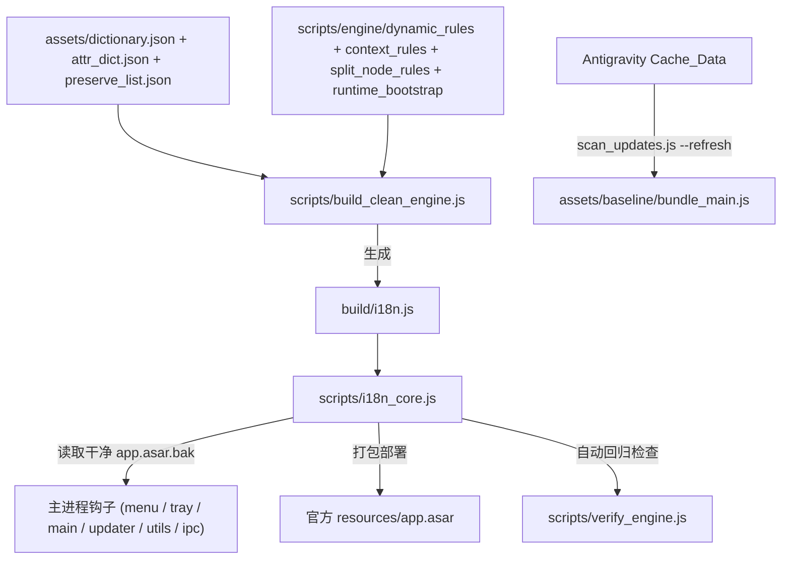

# Antigravity UI 汉化技术演进与模块化架构

---

## 一、技术演进与关键踩坑记录

1. **禁止在主进程接管 HTTPS（避坑铁律）**
   - 早期通过 `protocol.handle('https')` 拦截请求会导致本地自签名证书失效、界面卡死在 Loading 后闪退。现已彻底移除，保持官方网络与证书通道完全纯净。
2. **从模糊正则升级为“精确字典 + 严格动态模板 + 上下文消歧”**
   - 废除全局模糊拆词，确保术语统一且不破坏代码块、路径与终端输出。
   - 针对同一英文在不同界面含义不同的场景增加上下文隔离（例如 `New` 在新建按钮译为 `新建`、在模型标签徽章译为 `新`；`None` 在分组方式中译为 `不分组`、在思考深度选择器中译为 `关闭思考`、其余场景译为 `无`）。
3. **攻克 React JSX 相邻文本碎片与延迟浮层**
   - 针对数字/链接/标签打断的节点在 `scripts/engine/split_node_rules.js` 独立处理。
   - 针对 Tooltip / HoverCard / Base UI Portal 增加捕获阶段事件及短延时重扫，防止悬停内容闪烁或漏翻。
4. **2026-11 工程化重构**
   - 将多版历史脚本及 2400+ 行单文件拆分为清晰的 `assets/`、`scripts/engine/`、`build/`、`docs/`。
   - 停止构建脚本硬编码反写 `dictionary.json` 的旧机制，使 `dictionary.json` 成为唯一静态数据源，并新增 `scan_updates.js` 解决客户端升级后基准文件过时、无法发现新增/改名英文的问题。

---

## 二、当前完整架构

